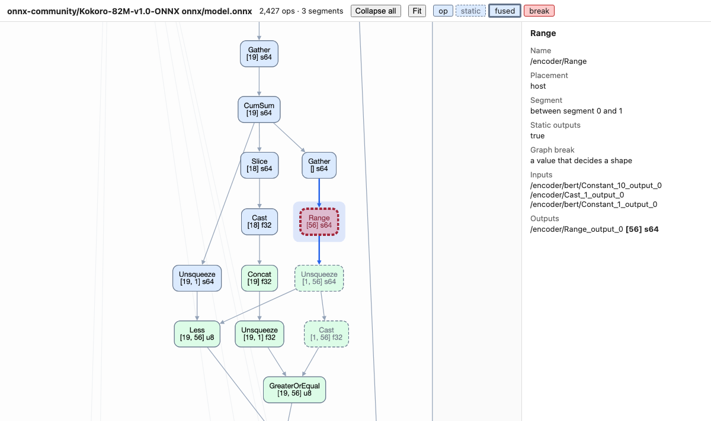

# Transmuter ⚗️

Transmuter runs Hugging Face [ONNX](https://onnx.ai) models on any Nx backend, with no per-architecture code. Use EMLX on Apple silicon, or EXLA on CUDA or on the CPU.

The goal of Transmuter is to implement the ONNX operators in Nx. Then ONNX models run without model code.

An ONNX file contains a graph of operators. An operator is one small, standard computation, such as `MatMul`, `Conv`, `Softmax`, `Add` or `Reshape`. Each operator has inputs, outputs and attributes, for example the kernel size of a `Conv`. The ONNX standard defines about 200 operators, and a model connects a few hundred to a few thousand of them. When a model is exported, the exporter traces its forward pass and writes these operators to the file.

Transmuter implements each operator one time, as Nx operations. It then runs a model by running its graph, operator by operator. So Transmuter does not port model architectures. A new architecture needs no new Elixir code. It needs only operators that Transmuter already has.

## The gap

Elixir has three ways to run Hugging Face models today. Each way has a limit:

- **Bumblebee** runs models with great accuracy on all Nx backends. But a person must port each architecture to Axon by hand, and a port takes weeks of work and review. Hugging Face gets new architectures faster than people can port them.
- **Ortex** runs ONNX models with ONNX Runtime. But it runs outside of Nx: you cannot put it in a `defn` function, it has no Apple silicon GPU path, and it is in maintenance mode.
- **axon_onnx** changed ONNX graphs into Axon models. It stopped in 2024. It set all shapes when it loaded a model, and many ONNX graphs need shapes that change.

Transmuter fills this gap. It runs the exported graph directly as Nx operations, so:

- Models that Bumblebee does not have run with no new code. Examples are SAM, Depth Anything, Grounding DINO, OWLv2, Florence-2, RF-DETR, Kokoro and Stable Diffusion.
- The result is plain Nx. It runs on EMLX and EXLA, it works with `Nx.Serving`, and `Nx.Defn.grad` can differentiate it.
- Shapes are set when the function compiles, not when the model loads. Thus decoders with a KV cache and graphs with `If` branches work.

When a model has no ONNX file on Hugging Face, export it one time with [Optimum](https://huggingface.co/docs/optimum/exporters/onnx/usage_guides/export_a_model). In the 300 most downloaded transformers models, 62% of downloads already have an ONNX file on Hugging Face.

## Example

`Transmuter.Text` gives servings that take text, as in Bumblebee. A serving loads the ONNX file, the tokenizer and the configuration of a Hugging Face repository, and returns an `Nx.Serving`:

```elixir
opts = [backend: EMLX.Backend, defn_options: [compiler: EMLX]]

serving = Transmuter.Text.text_embedding({:hf, "Xenova/all-MiniLM-L6-v2"}, opts)
Nx.Serving.run(serving, "The cat sat on the mat.")
#=> %{embedding: #Nx.Tensor<f32[384] ...>}

serving = Transmuter.Text.generation({:hf, "onnx-community/Qwen3-0.6B-ONNX"}, opts)
Nx.Serving.run(serving, %{messages: [%{role: "user", content: "What is the capital of France?"}], seed: 7})
#=> %{results: [%{text: "<think>\n...</think>\n\nThe capital of France is **Paris, France**.",
#=>               token_summary: %{input: 15, output: 167, padding: 0}}]}
```

The tasks:

- [`Transmuter.Text`](https://hexdocs.pm/transmuter/Transmuter.Text.html)
  - [`text_embedding`](https://hexdocs.pm/transmuter/Transmuter.Text.html#text_embedding/2): MiniLM, BGE, EmbeddingGemma and Qwen3-Embedding
  - [`text_classification`](https://hexdocs.pm/transmuter/Transmuter.Text.html#text_classification/2): DistilBERT and other sequence classifiers
  - [`text_ranking`](https://hexdocs.pm/transmuter/Transmuter.Text.html#text_ranking/2): MS MARCO cross-encoders and Qwen3-Reranker
  - [`zero_shot_entity_recognition`](https://hexdocs.pm/transmuter/Transmuter.Text.html#zero_shot_entity_recognition/2): GLiNER (span and token models)
  - [`zero_shot_classification`](https://hexdocs.pm/transmuter/Transmuter.Text.html#zero_shot_classification/3): DistilBERT MNLI and other NLI models
  - [`token_classification`](https://hexdocs.pm/transmuter/Transmuter.Text.html#token_classification/2): BERT NER
  - [`fill_mask`](https://hexdocs.pm/transmuter/Transmuter.Text.html#fill_mask/2): DistilRoBERTa
  - [`question_answering`](https://hexdocs.pm/transmuter/Transmuter.Text.html#question_answering/2): DistilBERT SQuAD
  - [`generation`](https://hexdocs.pm/transmuter/Transmuter.Text.html#generation/2): SmolLM2, SmolLM3, Qwen3 and Gemma 3
  - [`text_to_text`](https://hexdocs.pm/transmuter/Transmuter.Text.html#text_to_text/2): T5 and Marian, and NLLB and M2M100 for translation between many languages
- [`Transmuter.Vision`](https://hexdocs.pm/transmuter/Transmuter.Vision.html)
  - [`image_classification`](https://hexdocs.pm/transmuter/Transmuter.Vision.html#image_classification/2): ViT
  - [`image_embedding`](https://hexdocs.pm/transmuter/Transmuter.Vision.html#image_embedding/2): CLIP, SigLIP and SigLIP2
  - [`zero_shot_image_classification`](https://hexdocs.pm/transmuter/Transmuter.Vision.html#zero_shot_image_classification/3): CLIP, SigLIP and SigLIP2
  - [`image_to_text`](https://hexdocs.pm/transmuter/Transmuter.Vision.html#image_to_text/2): ViT-GPT2, TrOCR and Florence-2
  - [`image_text_to_text`](https://hexdocs.pm/transmuter/Transmuter.Vision.html#image_text_to_text/2): chats about images with SmolVLM, Qwen2-VL and Qwen3-VL
  - [`object_detection`](https://hexdocs.pm/transmuter/Transmuter.Vision.html#object_detection/2): DETR, YOLOS, RT-DETR and RF-DETR
  - [`zero_shot_object_detection`](https://hexdocs.pm/transmuter/Transmuter.Vision.html#zero_shot_object_detection/3): OWL-ViT, OWLv2 and Grounding DINO
  - [`depth_estimation`](https://hexdocs.pm/transmuter/Transmuter.Vision.html#depth_estimation/2): Depth Anything
  - [`image_segmentation`](https://hexdocs.pm/transmuter/Transmuter.Vision.html#image_segmentation/2): Segformer
  - [`background_removal`](https://hexdocs.pm/transmuter/Transmuter.Vision.html#background_removal/2): ORMBG
  - [`mask_generation`](https://hexdocs.pm/transmuter/Transmuter.Vision.html#mask_generation/2): SAM and SAM 2, with point and box prompts
  - [`image_to_image`](https://hexdocs.pm/transmuter/Transmuter.Vision.html#image_to_image/2): Swin2SR super resolution
- [`Transmuter.Audio`](https://hexdocs.pm/transmuter/Transmuter.Audio.html)
  - [`speech_to_text`](https://hexdocs.pm/transmuter/Transmuter.Audio.html#speech_to_text/2): Whisper
  - [`audio_classification`](https://hexdocs.pm/transmuter/Transmuter.Audio.html#audio_classification/2): AST and wav2vec2
  - [`zero_shot_audio_classification`](https://hexdocs.pm/transmuter/Transmuter.Audio.html#zero_shot_audio_classification/3): CLAP
  - [`text_to_speech`](https://hexdocs.pm/transmuter/Transmuter.Audio.html#text_to_speech/2): VITS and SpeechT5

The results have the shapes of Bumblebee or of Python transformers, and their values match the pipelines of Python transformers. The text of `image_text_to_text` matches ONNX Runtime on the same files. See the [Pipelines guide](guides/pipelines.md).

## Tensors

For a model that has no serving, give tensors to the graph:

```elixir
model = Transmuter.load!({:hf, "Xenova/all-MiniLM-L6-v2", "onnx/model.onnx"}, backend: EMLX.Backend)

inputs = %{
  "input_ids" => Nx.tensor([[101, 7592, 2088, 102]]),
  "attention_mask" => Nx.tensor([[1, 1, 1, 1]]),
  "token_type_ids" => Nx.tensor([[0, 0, 0, 0]])
}

run = Transmuter.compile(model, inputs, compiler: EMLX)
%{"last_hidden_state" => hidden} = run.(inputs)

# Sentence embedding: mean of the token vectors, then L2 normalization.
mask = Nx.new_axis(inputs["attention_mask"], -1)
embedding = Nx.sum(Nx.multiply(hidden, mask), axes: [1]) |> Nx.divide(Nx.sum(mask, axes: [1]))
embedding = Nx.divide(embedding, Nx.LinAlg.norm(embedding, axes: [1], keep_axes: true))
```

The export sets the names of the inputs and outputs. `model.inputs` and `model.outputs` show them. For this export, `model.outputs` is `["last_hidden_state"]`.

Transmuter runs the graph that is in the file, and nothing more. The graph of all-MiniLM-L6-v2 stops at the token vectors, because sentence-transformers adds the pooling outside of the model. Thus the example above does the pooling. `Transmuter.Text.text_embedding/2` does the tokenization, the pooling and the batching for you.

`Transmuter.compile/3` compiles the model for the shapes of the inputs that you give. The function that it returns also takes inputs of other shapes: it compiles them on their first call, and keeps the most recently used shapes compiled. The `:cache_size` option sets how many, and the default is 8.

`Transmuter.run/4` is the function that `Transmuter.compile/3` compiles. It reads the ONNX graph and calls one Nx function for each operator. You can use it in two ways:

- Call it directly. Each operator runs immediately, one after the other. This is eager execution. It is slower, but the model can read values while it runs.
- Give it to `Nx.Defn.jit/2` or `Nx.Defn.value_and_grad/2`. Nx then records the operators as one graph, and the backend compiles that graph.

## Installation

```elixir
def deps do
  [
    {:transmuter, "~> 1.0"},
    {:emlx, "~> 0.5"},
    {:tokenizers, "~> 0.5"}
  ]
end
```

Use EXLA instead of EMLX for CUDA. The `Transmuter.Text` servings need `tokenizers`. To read image files for the `Transmuter.Vision` servings, add `{:stb_image, "~> 1.0"}`. Chat templates need `{:otera, "~> 0.1"}`, which renders Jinja templates in pure Elixir.

## Compilation and graph breaks

Some graphs use a tensor value to set a shape or to select a branch. `Transmuter.compile/3` breaks the graph at these operators, runs the break eagerly on the real values, and compiles the next segment for the shapes the values decide. Compiled segments are cached by input shapes.

See the [Compiling and Graph Breaks guide](guides/graph_breaks.md) for a full explanation of graph breaks, static inputs, the `:cache_size` option, and how to read error messages. The [Backends and Performance guide](guides/backends_and_performance.md) explains EMLX memory management.

## See the graph

`Transmuter.Graph` shows the graph of a model with what Transmuter does to it. The fill of a node gives its segment, and a red node is a graph break with its reason. A node with static outputs has a dashed border, and a node that replaces fused nodes has a thick border. Click a node to see its details, such as the shapes of its outputs.



There are three ways to get the view:

- In Livebook, call `Transmuter.Graph.as_graph(model, inputs: inputs)`. It needs the optional `kino` dependency.
- Outside Livebook, call `Transmuter.Graph.to_html(model, "graph.html", inputs: inputs)` and open the file in a browser.
- From the command line, run `mix transmuter.graph onnx-community/Kokoro-82M-v1.0-ONNX --run --open`. It calls the model once with inputs of ones.

The view loads no file from the network. For the graph as the exporter wrote it, without fusion and without a call, run `mix transmuter.graph onnx-community/Kokoro-82M-v1.0-ONNX --plain`.

## Non-tensor values and random operators

Nx tensors hold only numbers. Transmuter keeps string tensors, sequences, and empty optionals as Elixir terms. Give string and sequence inputs as `:static_inputs`. A compiled function returns only tensors. To read string or sequence outputs, call `Transmuter.run/4` without compilation. Random operators draw from `Nx.Random`, and each call of a compiled model draws new values. `ImageDecoder` needs the optional `stb_image` dependency.

See [Supported Operators and Data Types](guides/supported_operators.md) for details.

## Telemetry

Transmuter emits `:telemetry` events when it loads, compiles and runs a model. The graph break events show which segment compiles again and for which shapes, which segment the cache evicts, and how long each break operator runs. `Transmuter.Telemetry` lists each event with its measurements and metadata.

To log the compile work, attach the logger when your application starts:

```elixir
Transmuter.Telemetry.Logger.attach()
```

## Precision and quantization

Half-precision exports run in native f16 or bf16 by default, with half the memory of f32. `compute_type: :f32` runs them in f32, as ONNX Runtime on the CPU does, for deep graphs that drift in native f16. With `backend: EMLX.Backend`, 4-bit and 8-bit `MatMulNBits` weights stay packed as MLX quantized tensors for lower peak memory and faster inference.

See the [Backends and Performance guide](guides/backends_and_performance.md) and the [Language Models guide](guides/language_models.md) for details and benchmarks.

## Fine-tuning

`Transmuter.run/4` is plain Nx. Thus `Nx.Defn.value_and_grad/2` calculates gradients through the graph, and an optimizer such as Polaris updates the params. Load the model with `trainable: true`. Then small weights, such as a bias with 1 element, are params and not constants.

`bench/finetune.exs` fine-tunes a MiniLM cross-encoder. Its gradients and its loss curve for 30 AdamW steps are the same as in PyTorch.

Fine-tune an fp32 export. Inference exports have no dropout, and quantized weights have no gradients.

## Coverage

`bench/coverage` runs the most downloaded ONNX exports for each Hugging Face task. It compares each output with ONNX Runtime. The reference is ONNX Runtime with graph optimizations off, because its default optimizer gives wrong results for some exports. For `MatMulNBits`, the reference uses `accuracy_level` 0. At level 4, ONNX Runtime quantizes the activations to int8, and that result is an approximation.

| Corpus | Result |
|---|---|
| Top exports for each Hugging Face task | 75 of 77 repositories, 112 of 114 files match |
| q4, int8 and fp16 variants of 10 repositories | all 12 q4 files match; int8 and fp16 are within the noise of ONNX Runtime |
| Models requested in Bumblebee issues | 11 of 12 files match. The Stable Diffusion VAE encoder samples noise |
| Image classifiers from the ONNX Model Zoo, with the int8 VGG16, AlexNet and ZFNet | 7 of 7 match |
| Faster R-CNN 10 and 12 and Mask R-CNN 12 from the ONNX Model Zoo | 3 of 3 match |
| Models that Bumblebee pull requests add: GLiNER, Nomic BERT, ColBERT, MPNet, Jina BERT v2, Swin, M2M100, NLLB, Llama 3.2, Phi-3.5, SmolLM3, Qwen3-VL, Gemma 4 and Ministral 3 | 18 of 21 files match. The Phi-3.5 q4f16 file is within noise. The Gemma 4 decoder differs, see below. The Ministral 3 vision encoder times out at its 1540x1540 input |
| Small language models: Granite 4.0-H (hybrid with Mamba-2 layers), LFM2-8B-A1B (mixture of experts), Gemma 3, Phi-4-mini, Qwen3, DeepSeek-R1-Distill, Falcon3, TinyLlama, MobileLLM-R1 and Baguettotron | 11 of 11 q4 files match |
| SigLIP and SigLIP2: the full model, the vision model and the text model | 6 of 6 match |
| One graph for each operator variant | 255 of 255 match |

Transmuter supports all 203 operators of the ONNX standard domain, and the ONNX Runtime contrib operators that Hugging Face exports use, including the mixture-of-experts operators `MoE` and `QMoE`.

Three models do not match value by value, because they make small rounding differences large:

- **Grounding DINO** selects 900 of 13,294 queries with `TopK`, and some scores differ by only 9.5e-7. All operators before `TopK` match. On `test/fixtures/cats.png` with three labels, Transmuter gives the same labels and number of detections as ONNX Runtime, with scores within 0.001.
- **The Gemma 4 E2B decoder** has activations up to about 1300 and final norm weights up to about 700. When the test changes the float inputs of ONNX Runtime by 1e-7 of their values, about one f32 rounding step, the logits of ONNX Runtime change by up to 5.5. The logits of Transmuter differ from ONNX Runtime by 5.3 on the CPU and by 13.6 on the GPU, which is the same noise. The two give the same token for 7 of 8 positions of the random test input.
- **Kokoro** sums a phase over all audio samples and takes its STFT. ONNX Runtime and MLX round that sum differently. Also, the `atan2` of the export gives a different phase for an exact STFT than for the STFT of ONNX Runtime (see [The atan2 fix](guides/speech_and_audio.md#the-atan2-fix)). When the test gives the `Sin` and `STFT` outputs of ONNX Runtime to Transmuter, all other operators match. With the `atan2` fix of the example, the spectrum of the speech matches PyTorch, with no tone at 4.8 kHz.

These models also ran from input to final result, and the result agrees with ONNX Runtime:

| Model | Check |
|---|---|
| [Kokoro-82M](https://huggingface.co/onnx-community/Kokoro-82M-v1.0-ONNX) | Speech for inputs of up to 505 phonemes. With the `atan2` fix of the example, the spectrum matches PyTorch |
| [Grounding DINO tiny](https://huggingface.co/onnx-community/grounding-dino-tiny-ONNX) | The same labels and number of detections on `test/fixtures/cats.png`, with scores within 0.001 |
| [MMS-TTS English](https://huggingface.co/Xenova/mms-tts-eng) | With the random values of ONNX Runtime, the same audio length and a waveform within 6e-5. Without noise, `text_to_speech` gives the audio length of PyTorch and a waveform within 1e-4 |
| [SpeechT5](https://huggingface.co/Xenova/speecht5_tts) | With a decoder dropout that keeps all values, `text_to_speech` gives the audio length of PyTorch and a waveform within 1e-4 |
| [SAM 2.1 tiny](https://huggingface.co/onnx-community/sam2.1-hiera-tiny-ONNX) | The same masks (IoU 1.0) for 1 point, 3 points, a box, and a box with a point |
| [Moonshine base](https://huggingface.co/onnx-community/moonshine-base-ONNX) | The same tokens for 2 s, 6 s and 15 s of speech |
| [Parakeet TDT 110M](https://huggingface.co/csukuangfj/sherpa-onnx-nemo-parakeet_tdt_transducer_110m-en-36000) (sherpa-onnx export) | The same transcripts for 2 s, 6 s and 15 s of speech, with the encoder, the LSTM decoder and the joiner in Transmuter |
| [wav2vec2 base 960h](https://huggingface.co/Xenova/wav2vec2-base-960h) | The same CTC transcripts for 2 s, 6 s and 15 s of speech |
| [Piper en_US lessac medium](https://huggingface.co/rhasspy/piper-voices) | The same audio length and a waveform within 1.3e-5, with the noise scales at 0 |
| [Florence-2 base](https://huggingface.co/onnx-community/Florence-2-base-ft) | `image_to_text` gives the tokens of the beam search of Python transformers on the image features of the export, for 6 tasks. The vision encoder of the export differs from PyTorch, see [The Florence-2 vision encoder](#the-florence-2-vision-encoder) |
| [SmolVLM 256M](https://huggingface.co/HuggingFaceTB/SmolVLM-256M-Instruct) | The same 100 tokens for an image with 13 tiles |
| [EmbeddingGemma 300M](https://huggingface.co/onnx-community/embeddinggemma-300m-ONNX) | `text_embedding` within 9.3e-7 of ONNX Runtime for 9 and 543 tokens. The export attends to all tokens, but the model has a sliding window of 512 tokens. So a text of more than 512 tokens differs from sentence-transformers (cosine 0.983 at 543 tokens), and a short text differs by up to 5.6e-4 |
| [Qwen2-VL 2B](https://huggingface.co/onnx-community/Qwen2-VL-2B-Instruct) | With the vision features of ONNX Runtime, the q4 decoder gives the same 60 tokens for two images of different sizes. The fp32 vision encoder is within 2e-5. With the fp32 vision encoder, `image_text_to_text` gives the greedy text of ONNX Runtime, up to 24 tokens, for a wide image, a tall image and a chat without images |
| [InsightFace buffalo_l](https://huggingface.co/WePrompt/buffalo_l) | SCRFD detection within 2.7e-5, and ArcFace embeddings with a cosine similarity of 1.0 to ONNX Runtime |
| [RapidOCR](https://github.com/RapidAI/RapidOCR) (PaddleOCR v4) | The same text for three lines of rendered text, after detection, cropping and recognition |
| [Real-ESRGAN x4](https://huggingface.co/imgdesignart/realesrgan-x4-onnx) | The upscaled image within 1.3e-5 |
| [SD-Turbo](https://huggingface.co/Heliosoph/sd-turbo-onnx) | The UNet within 2e-6 and the text encoder within 7.6e-5, then 4-step images |
| [Chronos-Bolt tiny](https://huggingface.co/bakshinghampalace/chronos-bolt-tiny-onnx) | The quantile forecasts within 1.2e-6 |
| Qwen3-0.6B FP8, exported with FLOAT8E4M3FN weights | The same 30 tokens, with logits within 4.5e-5 |
| Qwen3-0.6B with YaRN rope scaling, exported | The same 30 tokens, compiled and without compilation |
| FaceNet (InceptionResnetV1), exported | Embeddings within 1e-7 |
| ControlNet scribble and the SD 1.5 UNet with ControlNet inputs, exported | ControlNet residuals within 3.8e-5, then a scribble-to-image run |

### The Florence-2 vision encoder

The `vision_encoder.onnx` of `onnx-community/Florence-2-base-ft` gives other image features than PyTorch. Transmuter gives the features of ONNX Runtime, so its text is that of the export. The channel attention of DaViT multiplies the queries by `tokens ** -0.5`. The export computed this scale for a 224x224 input and stored it as a constant: the 12 `Mul` nodes `/blocks.N/blocks.N.M/channel_block/channel_attn/fn/Mul` have 1/56 (stage 0), 1/28 (stage 1), 1/14 (the 9 blocks of stage 2) and 1/7 (stage 3). The image processor resizes each image to 768x768, so the correct values are 1/192, 1/96, 1/48 and 1/24. The softmax of each channel attention is thus 3.43 times too sharp. The export of `Xenova/tiny-random-Florence2ForConditionalGeneration` has the same constants. On `test/fixtures/cats.png`, the image features differ from PyTorch by up to 6.1 (mean 0.44). With the correct constants, they differ by up to 1.9e-4.

The text changes for all 6 tasks of the tests (beam search with 3 beams):

| Task | Export | PyTorch |
|---|---|---|
| `<CAPTION>` | A couple of cats laying on top of a pink blanket. | Two cats laying on a pink blanket next to remotes. |
| `<MORE_DETAILED_CAPTION>` | There are two cats laying on top of a pink blanket. There is a white remote next to the cats. ... | There are two cats laying on a pink blanket. There are remotes next to the cats on the blanket. ... |
| `<OD>` | 2 cats and 2 remotes | Also a bed. The other boxes move by up to 7 bins of 1/1000 of the image |
| `<CAPTION_TO_PHRASE_GROUNDING>` "two cats" | 3 boxes | The same 3 boxes, moved by up to 3 bins |
| `<REFERRING_EXPRESSION_SEGMENTATION>` "a cat" | A polygon around the left cat, with repeated points | A polygon around the right cat |
| `<OCR_WITH_REGION>` (`test/fixtures/handwriting.png`) | Meet the at the station at noon. | Meet me at the station 'at noon. |

With the correct constants, the export gives the text of PyTorch for all 6 tasks. To get it, change the 12 initializers of the `Mul` nodes to `tokens ** -0.5` for a 768x768 input, as `test/support/pipeline_references.py` does, and save the file.

<details>
<summary>All tested models</summary>

"Within noise" means a precision variant that differs from ONNX Runtime by its rounding noise. "Random" means a model that samples random values.

| Model | Task | Parameters | Files | Compared with ONNX Runtime |
|---|---|---|---|---|
| [onnx-community/wav2vec2-base-Speech_Emotion_Recognition-ONNX](https://huggingface.co/onnx-community/wav2vec2-base-Speech_Emotion_Recognition-ONNX) | audio-classification | 94.6M | model | matches |
| [Xenova/ast-finetuned-audioset-10-10-0.4593](https://huggingface.co/Xenova/ast-finetuned-audioset-10-10-0.4593) | audio-classification | 86.6M | model | matches |
| [onnx-community/whisper-base](https://huggingface.co/onnx-community/whisper-base) | automatic-speech-recognition | 72.6M | decoder_model, decoder_model_merged, decoder_with_past_model, encoder_model | matches |
| [Xenova/whisper-tiny.en](https://huggingface.co/Xenova/whisper-tiny.en) | automatic-speech-recognition | 46M | decoder_model, decoder_model_merged, decoder_with_past_model, encoder_model, decoder_model_merged_fp16, decoder_model_merged_q4, decoder_model_merged_quantized, encoder_model_fp16, encoder_model_q4, encoder_model_quantized | decoder_model, decoder_model_merged, decoder_with_past_model, encoder_model, decoder_model_merged_q4, encoder_model_q4 match; decoder_model_merged_fp16, decoder_model_merged_quantized, encoder_model_fp16, encoder_model_quantized within noise |
| [onnx-community/depth-anything-v2-base](https://huggingface.co/onnx-community/depth-anything-v2-base) | depth-estimation | 97.2M | model | matches |
| [onnx-community/depth-anything-v2-small](https://huggingface.co/onnx-community/depth-anything-v2-small) | depth-estimation | 24.7M | model | matches |
| [Xenova/depth-anything-small-hf](https://huggingface.co/Xenova/depth-anything-small-hf) | depth-estimation | 24.7M | model | matches |
| [facebook/contriever](https://huggingface.co/facebook/contriever) (exported with Optimum) | feature-extraction | 109M | model | matches |
| [microsoft/markuplm-base](https://huggingface.co/microsoft/markuplm-base) (exported with Optimum) | feature-extraction | 133M | model | matches |
| [onnx-community/embeddinggemma-300m-ONNX](https://huggingface.co/onnx-community/embeddinggemma-300m-ONNX) | feature-extraction | 309M | model, model_no_gather_q4, model_q4, model_quantized | matches |
| [onnx-community/Qwen3-Embedding-0.6B-ONNX](https://huggingface.co/onnx-community/Qwen3-Embedding-0.6B-ONNX) | feature-extraction | 600M | model | matches |
| [Xenova/all-MiniLM-L6-v2](https://huggingface.co/Xenova/all-MiniLM-L6-v2) | feature-extraction | 22.6M | model, model_fp16, model_int8, model_q4, model_quantized | matches |
| [Xenova/bge-base-en-v1.5](https://huggingface.co/Xenova/bge-base-en-v1.5) | feature-extraction | 109M | model | matches |
| [Xenova/bge-small-en-v1.5](https://huggingface.co/Xenova/bge-small-en-v1.5) | feature-extraction | 33.2M | model | matches |
| [jinaai/jina-embeddings-v2-small-en](https://huggingface.co/jinaai/jina-embeddings-v2-small-en) | feature-extraction | 32.4M | model | matches |
| [Xenova/all-mpnet-base-v2](https://huggingface.co/Xenova/all-mpnet-base-v2) | feature-extraction | 109M | model | matches |
| [answerdotai/answerai-colbert-small-v1](https://huggingface.co/answerdotai/answerai-colbert-small-v1) | feature-extraction | 33.2M | model | matches |
| [nomic-ai/nomic-embed-text-v1.5](https://huggingface.co/nomic-ai/nomic-embed-text-v1.5) | feature-extraction | 137M | model | matches |
| [google/bigbird-roberta-base](https://huggingface.co/google/bigbird-roberta-base) (exported with Optimum) | fill-mask | 166M | model | matches |
| [microsoft/mdeberta-v3-base](https://huggingface.co/microsoft/mdeberta-v3-base) (exported with Optimum) | fill-mask | 472M | model | matches |
| [Xenova/bert-base-multilingual-cased](https://huggingface.co/Xenova/bert-base-multilingual-cased) | fill-mask | 178M | model | matches |
| [Xenova/bert-base-uncased](https://huggingface.co/Xenova/bert-base-uncased) | fill-mask | 110M | model, model_fp16, model_q4, model_quantized | model, model_fp16, model_q4 match; model_quantized within noise |
| [Xenova/distilbert-base-uncased](https://huggingface.co/Xenova/distilbert-base-uncased) | fill-mask | 67M | model | matches |
| [onnx-community/vit-base-violence-detection-ONNX](https://huggingface.co/onnx-community/vit-base-violence-detection-ONNX) | image-classification | 85.7M | model | matches |
| [Xenova/facial_emotions_image_detection](https://huggingface.co/Xenova/facial_emotions_image_detection) | image-classification | 85.8M | model | matches |
| [Xenova/vit-base-patch16-224](https://huggingface.co/Xenova/vit-base-patch16-224) | image-classification | 86.7M | model, model_fp16, model_q4, model_quantized | model, model_fp16, model_q4 match; model_quantized within noise |
| bvlcalexnet-12-int8 (ONNX Model Zoo) | image-classification | 61M | bvlcalexnet-12-int8 | matches |
| densenet-12 (ONNX Model Zoo) | image-classification | 8.15M | densenet-12 | matches |
| emotion-ferplus-8 (ONNX Model Zoo) | image-classification | 8.76M | emotion-ferplus-8 | matches |
| googlenet-12 (ONNX Model Zoo) | image-classification | 7M | googlenet-12 | matches |
| inception-v1-12 (ONNX Model Zoo) | image-classification | 7M | inception-v1-12 | matches |
| vgg16-12-int8 (ONNX Model Zoo) | image-classification | 138M | vgg16-12-int8 | matches |
| zfnet512-12-int8 (ONNX Model Zoo) | image-classification | 87.3M | zfnet512-12-int8 | matches |
| [Xenova/swin-tiny-patch4-window7-224](https://huggingface.co/Xenova/swin-tiny-patch4-window7-224) | image-classification | 28.6M | model | matches |
| [Xenova/dino-vits16](https://huggingface.co/Xenova/dino-vits16) | image-feature-extraction | 21.7M | model | matches |
| [Xenova/dinov2-small](https://huggingface.co/Xenova/dinov2-small) | image-feature-extraction | 22.1M | model | matches |
| [onnx-community/ormbg-ONNX](https://huggingface.co/onnx-community/ormbg-ONNX) | image-segmentation | 44M | model | matches |
| [Xenova/modnet](https://huggingface.co/Xenova/modnet) | image-segmentation | 6.46M | model | matches |
| [Xenova/segformer-b0-finetuned-ade-512-512](https://huggingface.co/Xenova/segformer-b0-finetuned-ade-512-512) | image-segmentation | 3.75M | model | matches |
| MaskRCNN-12 (ONNX Model Zoo) | image-segmentation | 44.4M | MaskRCNN-12 | matches |
| [Xenova/tiny-random-Florence2ForConditionalGeneration](https://huggingface.co/Xenova/tiny-random-Florence2ForConditionalGeneration) | image-text-to-text | 5.16M | decoder_model, decoder_model_merged, decoder_with_past_model, embed_tokens, encoder_model, vision_encoder | matches |
| [Xenova/tiny-random-LlavaForConditionalGeneration](https://huggingface.co/Xenova/tiny-random-LlavaForConditionalGeneration) | image-text-to-text | 9.44M | decoder_model, decoder_model_merged, decoder_with_past_model, embed_tokens, vision_encoder | matches |
| [mistralai/Ministral-3-3B-Instruct-2512-ONNX](https://huggingface.co/mistralai/Ministral-3-3B-Instruct-2512-ONNX) | image-text-to-text | 4.29B | decoder_model_merged_q4, embed_tokens_q4, vision_encoder_q4 | decoder_model_merged_q4, embed_tokens_q4 match; vision_encoder_q4 times out |
| [onnx-community/Qwen3-VL-2B-Instruct-ONNX](https://huggingface.co/onnx-community/Qwen3-VL-2B-Instruct-ONNX) | image-text-to-text | 2.37B | decoder_model_merged_q4, embed_tokens_q4, vision_encoder | matches |
| [onnx-community/gemma-4-E2B-it-ONNX](https://huggingface.co/onnx-community/gemma-4-E2B-it-ONNX) | image-text-to-text | 5.64B | audio_encoder_q4, decoder_model_merged_q4, embed_tokens_q4, vision_encoder | audio_encoder_q4, embed_tokens_q4, vision_encoder match; decoder_model_merged_q4 differ, see below |
| [Xenova/swin2SR-classical-sr-x2-64](https://huggingface.co/Xenova/swin2SR-classical-sr-x2-64) | image-to-image | 12.1M | model | matches |
| [Xenova/swin2SR-lightweight-x2-64](https://huggingface.co/Xenova/swin2SR-lightweight-x2-64) | image-to-image | 1.03M | model | matches |
| [Xenova/swin2SR-realworld-sr-x4-64-bsrgan-psnr](https://huggingface.co/Xenova/swin2SR-realworld-sr-x4-64-bsrgan-psnr) | image-to-image | 12.1M | model | matches |
| [onnx-community/manga-ocr-base-ONNX](https://huggingface.co/onnx-community/manga-ocr-base-ONNX) | image-to-text | 115M | decoder_model, encoder_model | matches |
| [Xenova/trocr-small-handwritten](https://huggingface.co/Xenova/trocr-small-handwritten) | image-to-text | 61.4M | decoder_model, decoder_model_merged, decoder_with_past_model, encoder_model | matches |
| [Carve/LaMa-ONNX](https://huggingface.co/Carve/LaMa-ONNX) | inpainting | 51M | lama_fp32 | matches |
| [onnx-community/vitpose-base-simple](https://huggingface.co/onnx-community/vitpose-base-simple) | keypoint-detection | 85.9M | model | matches |
| [onnx-community/sam3-tracker-ONNX](https://huggingface.co/onnx-community/sam3-tracker-ONNX) | mask-generation | 473M | prompt_encoder_mask_decoder, vision_encoder | matches |
| [Xenova/sam-vit-base](https://huggingface.co/Xenova/sam-vit-base) | mask-generation | 187M | model, prompt_encoder_mask_decoder, vision_encoder | matches |
| [Xenova/slimsam-50-uniform](https://huggingface.co/Xenova/slimsam-50-uniform) | mask-generation | 28M | prompt_encoder_mask_decoder, vision_encoder | matches |
| [Xenova/slimsam-77-uniform](https://huggingface.co/Xenova/slimsam-77-uniform) | mask-generation | 9.73M | prompt_encoder_mask_decoder, vision_encoder | matches |
| [Xenova/tiny-random-RoFormerForMultipleChoice](https://huggingface.co/Xenova/tiny-random-RoFormerForMultipleChoice) | multiple-choice | 1.64M | model | matches |
| [onnx-community/rfdetr_nano-ONNX](https://huggingface.co/onnx-community/rfdetr_nano-ONNX) | object-detection | 26.9M | model | matches |
| [Xenova/detr-resnet-50](https://huggingface.co/Xenova/detr-resnet-50) | object-detection | 41.7M | model, model_fp16, model_q4, model_quantized | model, model_q4 match; model_fp16, model_quantized within noise |
| [Xenova/yolos-tiny](https://huggingface.co/Xenova/yolos-tiny) | object-detection | 6.49M | model | matches |
| FasterRCNN-10 (ONNX Model Zoo) | object-detection | 41.8M | FasterRCNN-10 | matches |
| FasterRCNN-12 (ONNX Model Zoo) | object-detection | 44.1M | FasterRCNN-12 | matches |
| [onnx-community/roberta-base-squad2-ONNX](https://huggingface.co/onnx-community/roberta-base-squad2-ONNX) | question-answering | 124M | model | matches |
| [Xenova/distilbert-base-cased-distilled-squad](https://huggingface.co/Xenova/distilbert-base-cased-distilled-squad) | question-answering | 65.2M | model | matches |
| [Xenova/distilbert-base-uncased-distilled-squad](https://huggingface.co/Xenova/distilbert-base-uncased-distilled-squad) | question-answering | 66.4M | model | matches |
| [onnx-community/paraphrase-multilingual-MiniLM-L12-v2-ONNX](https://huggingface.co/onnx-community/paraphrase-multilingual-MiniLM-L12-v2-ONNX) | sentence-similarity | 118M | model | matches |
| [onnx-community/ruri-v3-30m-ONNX](https://huggingface.co/onnx-community/ruri-v3-30m-ONNX) | sentence-similarity | 36.7M | model | matches |
| [onnx-community/USER2-small-ONNX](https://huggingface.co/onnx-community/USER2-small-ONNX) | sentence-similarity | 34.4M | model | matches |
| [onnx-community/Text-Summarizer-t5-small-ONNX](https://huggingface.co/onnx-community/Text-Summarizer-t5-small-ONNX) | summarization | 93.4M | decoder_model, decoder_model_merged, decoder_with_past_model, encoder_model | matches |
| [onnx-community/text_summarization-ONNX](https://huggingface.co/onnx-community/text_summarization-ONNX) | summarization | 77M | decoder_model, decoder_model_merged, decoder_with_past_model, encoder_model | matches |
| [onnx-community/distilbert-multilingual-toxicity-classifier-ONNX](https://huggingface.co/onnx-community/distilbert-multilingual-toxicity-classifier-ONNX) | text-classification | 135M | model | matches |
| [onnx-community/ModernBERT-base-nli-ONNX](https://huggingface.co/onnx-community/ModernBERT-base-nli-ONNX) | text-classification | 150M | model | matches |
| [SamLowe/roberta-base-go_emotions](https://huggingface.co/SamLowe/roberta-base-go_emotions) (exported with Optimum) | text-classification | 125M | model | matches |
| [Xenova/ms-marco-MiniLM-L-6-v2](https://huggingface.co/Xenova/ms-marco-MiniLM-L-6-v2) | text-classification | 22.7M | model | matches |
| [HuggingFaceTB/SmolLM2-135M-Instruct](https://huggingface.co/HuggingFaceTB/SmolLM2-135M-Instruct) | text-generation | 135M | model, model_fp16, model_q4, model_q4f16, model_quantized | model, model_q4 match; model_fp16, model_q4f16, model_quantized within noise |
| [HuggingFaceTB/SmolLM2-360M-Instruct](https://huggingface.co/HuggingFaceTB/SmolLM2-360M-Instruct) | text-generation | 362M | model | matches |
| [onnx-community/gemma-3-270m-it-ONNX](https://huggingface.co/onnx-community/gemma-3-270m-it-ONNX) | text-generation | 453M | model, model_fp16, model_q4, model_quantized | model, model_q4, model_quantized match; model_fp16 within noise |
| [onnx-community/LFM2-350M-ONNX](https://huggingface.co/onnx-community/LFM2-350M-ONNX) | text-generation | 430M | model, model_q4, model_quantized | matches |
| [onnx-community/Qwen2.5-0.5B-Instruct](https://huggingface.co/onnx-community/Qwen2.5-0.5B-Instruct) | text-generation | 498M | model | matches |
| [onnx-community/Qwen3-0.6B-ONNX](https://huggingface.co/onnx-community/Qwen3-0.6B-ONNX) | text-generation | 601M | model, model_q4, model_quantized | model, model_q4 match; model_quantized within noise |
| tiny random Falcon (exported with Optimum) | text-generation | 4.18M | model | matches |
| tiny random GPT-J (exported with Optimum) | text-generation | 131K | model | matches |
| [Xenova/gpt2](https://huggingface.co/Xenova/gpt2) | text-generation | 127M | model | matches |
| [Xenova/llama2.c-stories15M](https://huggingface.co/Xenova/llama2.c-stories15M) | text-generation | 30.4M | decoder_model, decoder_model_merged, decoder_with_past_model, model | matches |
| [Xenova/tiny-random-GemmaForCausalLM](https://huggingface.co/Xenova/tiny-random-GemmaForCausalLM) | text-generation | 2.05M | model | matches |
| [Xenova/tiny-random-Phi3ForCausalLM](https://huggingface.co/Xenova/tiny-random-Phi3ForCausalLM) | text-generation | 2.07M | model | matches |
| [onnx-community/Baguettotron-ONNX](https://huggingface.co/onnx-community/Baguettotron-ONNX) | text-generation | 321M | model_q4 | matches |
| [onnx-community/DeepSeek-R1-Distill-Qwen-1.5B-ONNX](https://huggingface.co/onnx-community/DeepSeek-R1-Distill-Qwen-1.5B-ONNX) | text-generation | 1.79B | model_q4 | matches |
| [onnx-community/Falcon3-1B-Instruct](https://huggingface.co/onnx-community/Falcon3-1B-Instruct) | text-generation | 1.67B | model_q4 | matches |
| [onnx-community/gemma-3-1b-it-ONNX](https://huggingface.co/onnx-community/gemma-3-1b-it-ONNX) | text-generation | 1.32B | model_q4 | matches |
| [onnx-community/granite-4.0-h-1b-ONNX](https://huggingface.co/onnx-community/granite-4.0-h-1b-ONNX) | text-generation | 1.97B | model_q4 | matches |
| [onnx-community/granite-4.0-h-350m-ONNX](https://huggingface.co/onnx-community/granite-4.0-h-350m-ONNX) | text-generation | 490M | model_q4 | matches |
| [onnx-community/LFM2-8B-A1B-ONNX](https://huggingface.co/onnx-community/LFM2-8B-A1B-ONNX) | text-generation | 4.85B | model_q4 | matches |
| [onnx-community/MobileLLM-R1-950M-ONNX](https://huggingface.co/onnx-community/MobileLLM-R1-950M-ONNX) | text-generation | 952M | model_q4 | matches |
| [onnx-community/Phi-4-mini-instruct-ONNX](https://huggingface.co/onnx-community/Phi-4-mini-instruct-ONNX) | text-generation | 4.46B | model_q4 | matches |
| [onnx-community/Qwen3-1.7B-ONNX](https://huggingface.co/onnx-community/Qwen3-1.7B-ONNX) | text-generation | 1.73B | model_q4 | matches |
| [Xenova/TinyLlama-1.1B-Chat-v1.0](https://huggingface.co/Xenova/TinyLlama-1.1B-Chat-v1.0) | text-generation | 1.1B | model_q4 | matches |
| [onnx-community/Phi-3.5-mini-instruct-onnx-web](https://huggingface.co/onnx-community/Phi-3.5-mini-instruct-onnx-web) | text-generation | 3.83B | model_q4f16 | within noise |
| [onnx-community/Llama-3.2-1B-Instruct-ONNX](https://huggingface.co/onnx-community/Llama-3.2-1B-Instruct-ONNX) | text-generation | 1.24B | model_q4 | matches |
| [HuggingFaceTB/SmolLM3-3B-ONNX](https://huggingface.co/HuggingFaceTB/SmolLM3-3B-ONNX) | text-generation | 3.08B | model_q4 | matches |
| [onnx-community/stable-diffusion-v1-5-ONNX](https://huggingface.co/onnx-community/stable-diffusion-v1-5-ONNX) | text-to-image | 1.07B | text_encoder/model, unet/model, vae_decoder/model, vae_encoder/model | text_encoder/model, unet/model, vae_decoder/model match; vae_encoder/model random |
| [onnx-community/Kokoro-82M-v1.0-ONNX](https://huggingface.co/onnx-community/Kokoro-82M-v1.0-ONNX) | text-to-speech | 81.2M | model | differs, see below |
| [onnx-community/granite-timeseries-patchtsmixer](https://huggingface.co/onnx-community/granite-timeseries-patchtsmixer) | time-series-forecasting | 196K | model | matches |
| [onnx-community/granite-timeseries-patchtst](https://huggingface.co/onnx-community/granite-timeseries-patchtst) | time-series-forecasting | 616K | model | matches |
| [Xenova/bert-base-multilingual-cased-ner-hrl](https://huggingface.co/Xenova/bert-base-multilingual-cased-ner-hrl) | token-classification | 177M | model | matches |
| [Xenova/bert-base-NER](https://huggingface.co/Xenova/bert-base-NER) | token-classification | 108M | model | matches |
| [Xenova/distilbert-base-multilingual-cased-ner-hrl](https://huggingface.co/Xenova/distilbert-base-multilingual-cased-ner-hrl) | token-classification | 135M | model | matches |
| [onnx-community/gliner_small-v2.1](https://huggingface.co/onnx-community/gliner_small-v2.1) | token-classification | 153M | model | matches |
| [Xenova/opus-mt-en-ROMANCE](https://huggingface.co/Xenova/opus-mt-en-ROMANCE) | translation | 111M | decoder_model, decoder_model_merged, decoder_with_past_model, encoder_model | matches |
| [Xenova/m2m100_418M](https://huggingface.co/Xenova/m2m100_418M) | translation | 617M | decoder_model_merged, encoder_model | matches |
| [Xenova/nllb-200-distilled-600M](https://huggingface.co/Xenova/nllb-200-distilled-600M) | translation | 1.06B | decoder_model_merged_q4, encoder_model_q4 | matches |
| [onnx-community/timesformer-base-finetuned-k400](https://huggingface.co/onnx-community/timesformer-base-finetuned-k400) | video-classification | 122M | model | matches |
| [onnx-community/silero-vad](https://huggingface.co/onnx-community/silero-vad) | voice-activity-detection | 545K | model | matches |
| [onnx-community/smart-turn-v3-ONNX](https://huggingface.co/onnx-community/smart-turn-v3-ONNX) | voice-activity-detection | 8M | model | matches |
| [Xenova/distilbert-base-uncased-mnli](https://huggingface.co/Xenova/distilbert-base-uncased-mnli) | zero-shot-classification | 67M | model | matches |
| [Xenova/mobilebert-uncased-mnli](https://huggingface.co/Xenova/mobilebert-uncased-mnli) | zero-shot-classification | 24.6M | model | matches |
| [Xenova/nli-deberta-v3-xsmall](https://huggingface.co/Xenova/nli-deberta-v3-xsmall) | zero-shot-classification | 70.8M | model | matches |
| [Xenova/chinese-clip-vit-base-patch16](https://huggingface.co/Xenova/chinese-clip-vit-base-patch16) | zero-shot-image-classification | 188M | model | matches |
| [Xenova/mobileclip_s0](https://huggingface.co/Xenova/mobileclip_s0) | zero-shot-image-classification | 53.8M | text_model, vision_model | matches |
| [Xenova/mobileclip_s2](https://huggingface.co/Xenova/mobileclip_s2) | zero-shot-image-classification | 99.1M | text_model, vision_model | matches |
| [Xenova/siglip-base-patch16-224](https://huggingface.co/Xenova/siglip-base-patch16-224) | zero-shot-image-classification | 203M | model, text_model, vision_model | matches |
| [onnx-community/siglip2-base-patch16-224-ONNX](https://huggingface.co/onnx-community/siglip2-base-patch16-224-ONNX) | zero-shot-image-classification | 375M | model, text_model, vision_model | matches |
| [onnx-community/grounding-dino-tiny-ONNX](https://huggingface.co/onnx-community/grounding-dino-tiny-ONNX) | zero-shot-object-detection | 179M | model | differs, see below |
| [Xenova/owlv2-base-patch16-ensemble](https://huggingface.co/Xenova/owlv2-base-patch16-ensemble) | zero-shot-object-detection | 153M | model | matches |
| [Xenova/owlvit-base-patch32](https://huggingface.co/Xenova/owlvit-base-patch32) | zero-shot-object-detection | 153M | model | matches |

</details>

To run the matrix:

1. Run `bench/coverage/select_models.py` to select the models.
2. Run `bench/coverage/record_references.py` to download them and record the ONNX Runtime outputs.
3. Run `bench/coverage/run_cases.py` to run each case through Transmuter.
4. Run `bench/coverage/print_matrix.py` to show the matrix, and `bench/coverage/list_models.py` to make the table of tested models.

If a case does not match, run `bench/coverage/trace_ort.py` and `bench/coverage/find_divergence.exs`. They show the first node where Transmuter and ONNX Runtime give different values.

## Tests

`mix test` downloads five models and compares them with ONNX Runtime. `test/support/model_references.py` shows the reference values.

`mix test` also runs one small graph for each operator variant in `test/fixtures/ops`, with no download. `test/support/make_op_fixtures.py` makes these graphs and records their outputs from ONNX Runtime, or from the ONNX reference evaluator when ONNX Runtime does not have the operator. For random operators, the tests check the shape, the type and the distribution of the values.

On a Mac, `TRANSMUTER_TEST_DEVICE=cpu mix test` uses the EMLX CPU device. But EMLX 0.5 runs compiled functions on the GPU when Metal is available, also with `device: :cpu`. Thus only the Linux CI tests the CPU fully.

## License

Apache-2.0
